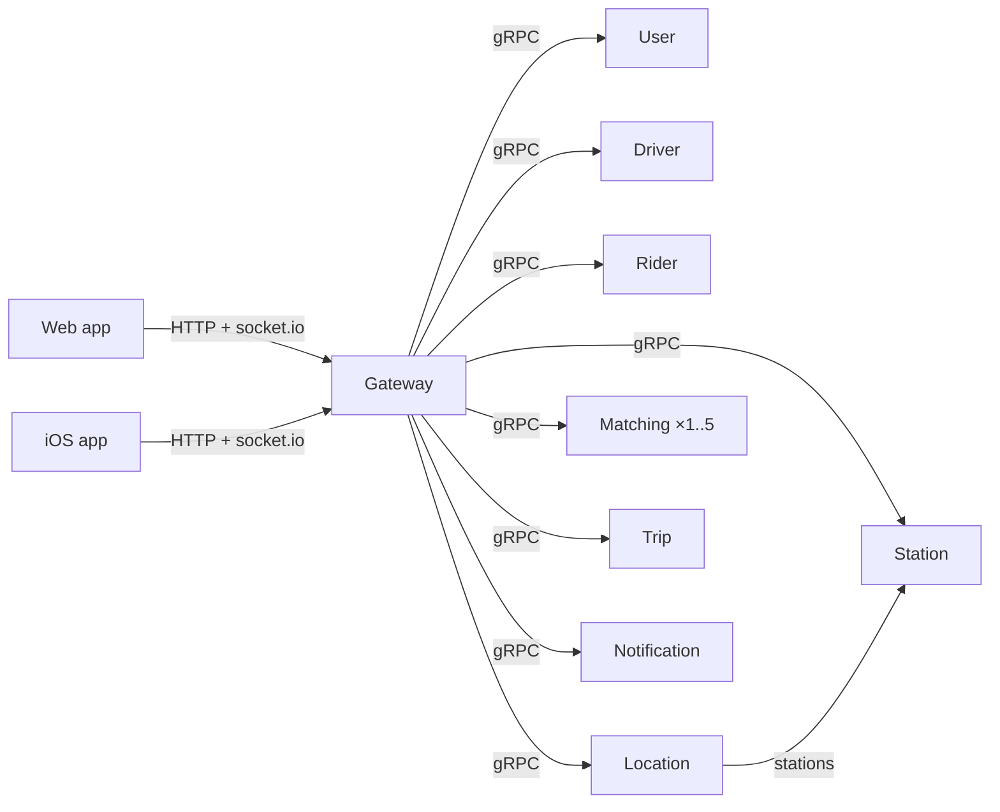

# LastMile

**Metro last-mile rides, built as gRPC microservices on Kubernetes.**

You step off the metro at Electronic City and your office is 2 km away.
LastMile matches you with a driver who is already heading that way, a few
minutes before they reach your station.



- **Matching** is stateless and scales from 1 to 5 replicas with an HPA.
- **Location** detects when a driver enters a station's approach zone; that
  is the moment matching runs.
- Every service is built on a small **microservice chassis** (health checks,
  graceful shutdown, client-side load balancing, retries).

## Run it

```bash
make race                    # tests (with the race detector)
scripts/run-local.sh         # every service as a local process
scripts/smoke.sh             # one complete ride, end to end
cd web && pnpm install && pnpm dev   # http://localhost:5173
```

Log in with a demo account (password `lastmile`): `driver@lastmile.demo` or
`rider@lastmile.demo`. No Supabase or internet needed.

More ways to run it:

```bash
docker compose up --build --scale matching=3   # containers; web on :8080
make k8s-up                                     # minikube
make help                                       # everything else
```

## Deploy

Production runs on **Render** (gateway, eight private microservices, the
web app as a static site) with **Supabase** for Postgres and optional Auth.
Every push to `main` that passes CI is migrated, deployed and verified by
GitHub Actions. Setup, costs (about $70/month, or $0 with the
single-container `render.free.yaml`) and troubleshooting:
[`docs/deploy.md`](docs/deploy.md).

**Live now** (free variant, sleeps when idle): the app at
<https://lastmile-web-ihr9.onrender.com>, the gateway at
<https://lastmile-stack.onrender.com/system/status>.

## Docs

| | |
|---|---|
| [`AGENTS.md`](AGENTS.md) | Architecture, rules, commands (also read by AI agents) |
| [`docs/demo/RUNBOOK.md`](docs/demo/RUNBOOK.md) | The live class demo, minute by minute |
| [`docs/demo/index.html`](docs/demo/index.html) | Interactive explainer: kill pods, scale Matching, watch it work |
| [`docs/ai-workflow.md`](docs/ai-workflow.md) | How this was built with AI agents, and what a review found |
| [`docs/architecture.md`](docs/architecture.md) | Design decisions mapped to *Microservices Patterns* |
| [`mobile/README.md`](mobile/README.md) | Expo/iOS client |
| [`docs/spec/`](docs/spec/) | Course specification |
