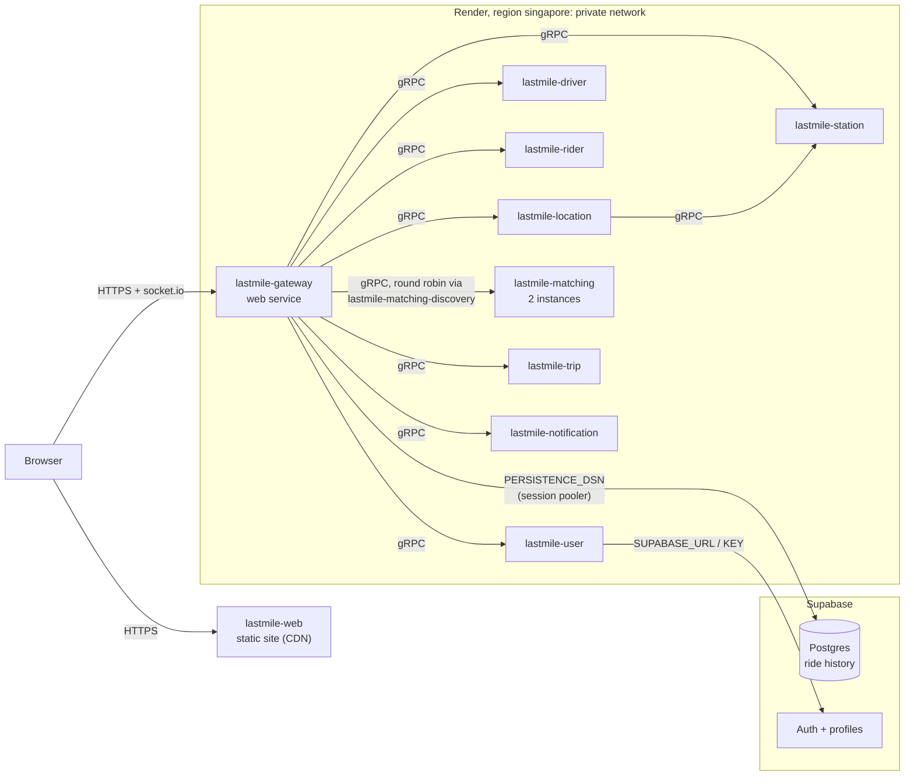

# Deploying LastMile: Render + Supabase

LastMile runs in production as **ten Render services** (the gateway, eight
microservices, the web app) and **one Supabase project** (Postgres for ride
history, optionally Auth for real accounts). GitHub Actions deploys: every
push to `main` that passes CI is migrated, deployed and checked
automatically, commit by commit.



| File | What it is |
|---|---|
| [`render.yaml`](../render.yaml) | The Render Blueprint: every service, how they are wired together, which secrets to ask for |
| [`render.free.yaml`](../render.free.yaml) | The $0 variant: the whole backend in one free web service ([below](#the-free-variant)) |
| [`supabase/migrations/`](../supabase/migrations) | The database schema, as ordered SQL files |
| [`scripts/db-migrate.sh`](../scripts/db-migrate.sh) | Applies the pending migrations; safe to run on every deploy |
| [`ci/supabase-emulation.sql`](../ci/supabase-emulation.sql) | Lets CI test the migrations on plain PostgreSQL 16 |
| [`.github/workflows/deploy.yml`](../.github/workflows/deploy.yml), [`scripts/render-deploy.sh`](../scripts/render-deploy.sh) | The deploy pipeline |

## What is live right now

The class deployment uses the [free variant](#the-free-variant), so it costs
nothing:

| | |
|---|---|
| App | <https://lastmile-web-ihr9.onrender.com> (Render static site `lastmile-web`) |
| Gateway | <https://lastmile-stack.onrender.com> (Render free web service `lastmile-stack`, region Singapore); `/healthz`, `/system/status` |
| Database | Supabase project **LastMile-app**; migrations `0001`–`0004` applied |
| Gateway → database | `PERSISTENCE_DSN` = session pooler, user `lastmile_app.<project-ref>` ([why](#a-separate-database-role-for-the-gateway)) |

Both Render services were created through the Render API, not from a
Blueprint, with auto-deploy off. They currently build from the branch
`claude/youthful-lovelace-ihg7ev`. **After that branch is merged, change
each service's branch to `main`** (service → **Settings → Build & Deploy →
Branch**). Otherwise the Deploy workflow asks Render for a `main` commit the
service doesn't track.

Check it from anywhere:

```bash
curl -s https://lastmile-stack.onrender.com/system/status | jq '.services[] | {name, status}'
GATEWAY=https://lastmile-stack.onrender.com scripts/smoke.sh
```

The first request after 15 idle minutes takes about 15 to 60 seconds,
because a free instance sleeps. **Open the app a few minutes before class.**

## How it runs on Render

- **The gateway is the only public backend.** It is a Render *web service*
  with an `https://lastmile-gateway.onrender.com`-style URL. It listens on
  `$PORT` (10000) and Render checks `GET /healthz` before sending it traffic.
- **The eight microservices are *private services*.** They have no public
  URL; only other services in the same workspace and region can reach them,
  over Render's private network. Each listens for gRPC on port 10000 (each
  has its own container and IP, so the same port is fine). The gateway gets
  their `host:port` addresses from `fromService` references in
  `render.yaml`, so nothing is hard-coded.
- **Every Go service is built from the root `Dockerfile`.** It needs
  `--build-arg SERVICE=<name>`. Render passes a service's environment
  variables to its Docker build as build arguments, so each service in
  `render.yaml` sets `SERVICE` ([Render docs](https://render.com/docs/docker#environment-variable-translation)).
- **Matching runs two instances, and the gateway uses both.** Render
  load-balances a scaled service, but gRPC keeps one long-lived HTTP/2
  connection, so through the normal hostname every call would go to the same
  instance. Instead the gateway dials Matching's *discovery hostname*
  (`<internal-host>-discovery`), which resolves to the IP of every running
  instance ([Render docs](https://render.com/docs/private-network#direct-ip-communication-advanced)).
  `render.yaml` hands it over as `MATCHING_DISCOVERY_HOST` (Matching's
  `RENDER_DISCOVERY_SERVICE`) plus `MATCHING_PORT`, and the gateway dials
  `dns:///<that host>:10000` with gRPC's `round_robin` balancer
  ([`chassis.Target`](../internal/pkg/chassis/client.go)). Servers close
  connections every 30 s, so the gateway re-resolves and picks up new
  instances. Same trick as the headless Service in Kubernetes.
- **"Decided by …" in the app** shows Render's `RENDER_INSTANCE_ID` of the
  Matching instance that answered (`chassis.Instance()`).
- **The web app is a *static site*** on Render's CDN. Its build runs
  `npm install && npm run build` in `web/`; `render.yaml` gives it
  `GATEWAY_HOST` (the gateway's public hostname), which
  [`web/vite.config.ts`](../web/vite.config.ts) bakes in as
  `VITE_GATEWAY_URL=https://<host>`. Every path is rewritten to `index.html`
  for client-side routing.
- **Ride history goes to Supabase** when the gateway has `PERSISTENCE_DSN`
  set (tables `driver_routes`, `driver_route_pickups`, `rider_requests`,
  `trips`, `trip_events`). The live state stays in memory in the services;
  the database is the audit trail. Writes are best effort: if Supabase is
  down, rides still work and the gateway logs a warning.
- **Auto-deploy is off on every service** (and Blueprint *Auto Sync* should
  be off too, see setup). Render would otherwise deploy whatever was pushed,
  before CI finished. GitHub Actions deploys the exact commit CI tested,
  through the Render API. Changes to `render.yaml` itself (new variables,
  plans, instance counts) apply when you click **Manual Sync** on the
  Blueprint.

## One-time setup

You need a Render account, a Supabase account and admin rights on the
GitHub repository. About 20 minutes.

### 1. Supabase

1. Create a project at [supabase.com](https://supabase.com). Pick the
   region closest to your Render region (Singapore here: *Southeast Asia
   (Singapore)*). Keep the database password.
2. Click **Connect** at the top of the project page and copy the
   **Session pooler** URI. It looks like
   `postgresql://postgres.<project-ref>:<password>@aws-0-<region>.pooler.supabase.com:5432/postgres`.
   Add `?sslmode=require` at the end. This is your **database URL**, used
   twice below.
   - Use the pooler, not the *Direct connection* (`db.<ref>.supabase.co`):
     on the free plan the direct host is IPv6-only, and neither GitHub's
     runners nor Render reach it.
   - The *Transaction pooler* (port 6543) also works for the gateway (it
     switches pgx to a protocol without prepared statements automatically),
     but session mode is the simpler choice for a long-running server.
3. Optional, for real sign-up/sign-in instead of the demo accounts:
   **Project settings → API Keys**. Note the project URL
   (`https://<ref>.supabase.co`) and the **anon** key. With the anon key
   the User service can read `profiles` (publicly readable by design) and
   nothing else. For a demo, also turn off **Authentication → Sign In /
   Providers → Email → Confirm email**, or sign-up won't log you in until
   the email is confirmed.

The deploy pipeline applies `supabase/migrations` before every deploy, so
you don't write the schema yourself. To do it once now:
`SUPABASE_DB_URL='<database URL>' scripts/db-migrate.sh`.

4. Once the migrations have run, give the gateway its own login. Migration
   `0004` creates the role `lastmile_app` without a password. In the
   Supabase **SQL Editor**, set one (generate it, for example with
   `openssl rand -hex 24`, and don't commit it):

   ```sql
   alter role lastmile_app with login password '<generated>';
   ```

   The gateway's `PERSISTENCE_DSN` is then the same session pooler URI with
   the user `lastmile_app.<project-ref>` and that password:
   `postgresql://lastmile_app.<project-ref>:<generated>@aws-0-<region>.pooler.supabase.com:5432/postgres?sslmode=require`.
   Keep the `postgres` URL for `SUPABASE_DB_URL` only: migrations need it
   to create tables.

### 2. Render

1. In the [Render Dashboard](https://dashboard.render.com): **New →
   Blueprint**, connect your GitHub account and pick this repository. Render
   finds `render.yaml` (for the free variant set **Blueprint Path** to
   `render.free.yaml`).
2. Render lists the services it will create and asks for the `sync: false`
   values. Fill in what you have; empty is fine:

   | Service | Variable | Value | Empty means |
   |---|---|---|---|
   | `lastmile-gateway` | `PERSISTENCE_DSN` | the `lastmile_app` URL (step 1.4) | no ride history |
   | `lastmile-user` | `SUPABASE_URL` | `https://<ref>.supabase.co` | demo accounts |
   | `lastmile-user` | `SUPABASE_KEY` | the anon key | demo accounts |

   Render asks only this once. To change a value later, edit it on the
   service's **Environment** page (later Blueprint syncs never overwrite
   `sync: false` variables).
3. **Apply.** Render creates the services and deploys each one. The first
   build takes a few minutes per service.
4. Open `lastmile-gateway` and copy its URL
   (`https://lastmile-gateway.onrender.com`, possibly with a suffix if the
   name was taken). `https://…/system/status` should list every service as
   `SERVING`. Open `lastmile-web`'s URL to use the app; demo login
   `driver@lastmile.demo` / `rider@lastmile.demo`, password `lastmile`.
5. Open the Blueprint's **Settings** and set **Auto Sync** to **No**.
   Otherwise Render re-syncs and redeploys services by itself whenever
   `render.yaml` changes on `main`, without waiting for CI
   ([Render docs](https://render.com/docs/infrastructure-as-code#disabling-automatic-sync)).
   After a `render.yaml` change has passed CI, click **Manual Sync**.
6. **Account Settings → API Keys → Create API key.** Copy it: this is
   `RENDER_API_KEY`. It can manage every service in your workspaces, so
   treat it like a password.

### 3. GitHub

In the repository: **Settings → Secrets and variables → Actions**.

| Kind | Name | Value |
|---|---|---|
| Secret | `RENDER_API_KEY` | the Render API key |
| Secret | `SUPABASE_DB_URL` | the database URL as `postgres` (session pooler URI); migrations need a role that can create tables |
| Variable | `LASTMILE_GATEWAY_URL` | the gateway URL, e.g. `https://lastmile-gateway.onrender.com` (for the free variant: `https://lastmile-stack.onrender.com`) |
| Variable (optional) | `RENDER_SERVICES` | the services to deploy, space-separated. Free variant: `lastmile-stack lastmile-web`. Empty: everything in `render.yaml` that exists |

Then **Settings → Environments → New environment** named `production`.
The migrate and deploy jobs run in it; add *Required reviewers* there if
you want to approve each production deploy.

Until a secret exists, its step is skipped with a notice, so forks and a
half-finished setup stay green.

## What happens on every push to `main`

1. **CI** (`.github/workflows/ci.yml`): Go build, `go vet`, `go test -race`,
   the web build, and the migrations applied to a throwaway PostgreSQL 16
   (after `ci/supabase-emulation.sql`), twice, to prove they are idempotent.
2. **Deploy** (`.github/workflows/deploy.yml`) starts only if CI passed, and
   only for that commit:
   1. **migrate**: `scripts/db-migrate.sh` against Supabase. New code never
      runs against an old schema. If a migration fails, it is rolled back
      and nothing is deployed.
   2. **deploy**: `scripts/render-deploy.sh <sha>` asks the Render API to
      deploy that commit: all private services first, then the gateway,
      then the web app, waiting until each tier is live.
   3. **verify**: polls `$LASTMILE_GATEWAY_URL/healthz`, then checks that
      `/system/status` reports every service `SERVING`.

Render deploys with zero downtime: a new instance must pass its health
check before the old one is stopped, and a failed build or health check
leaves the previous version running.

## Database migrations

Each file in `supabase/migrations/` is `NNNN_snake_case.sql` and runs once,
in filename order. `scripts/db-migrate.sh`:

- records each applied file and its sha256 in
  `lastmile_meta.schema_migrations`;
- **refuses to run if an applied file was edited**: applied migrations are
  history. Change the schema with a new file (`0005_…sql`);
- runs each file in its own transaction together with its tracking row,
  under an advisory lock, so a failed file leaves nothing behind and two
  runs at once don't collide;
- `--status` lists applied and pending files without changing anything.

Write migrations that also work when the objects already exist (`create
table if not exists`, `add column if not exists`, `drop policy if exists`
then `create policy`): projects set up from the old `schema.sql` already
have most tables. Don't put `BEGIN`/`COMMIT` or `CREATE INDEX CONCURRENTLY`
in a file (the script refuses `BEGIN`/`COMMIT`).

Test locally against a scratch Postgres:

```bash
docker run -d --name pg -e POSTGRES_PASSWORD=pw -p 127.0.0.1:55432:5432 postgres:16
export SUPABASE_DB_URL=postgresql://postgres:pw@127.0.0.1:55432/postgres
psql "$SUPABASE_DB_URL" -v ON_ERROR_STOP=1 -f ci/supabase-emulation.sql
scripts/db-migrate.sh && scripts/db-migrate.sh   # the second run does nothing
```

Row Level Security is on for every table. `profiles` is readable by anyone
(the User service needs that) and writable only by its owner. The ride
tables have a policy for `lastmile_app` only, so the public API keys
(`anon`, `authenticated`) see nothing.

### A separate database role for the gateway

The gateway only reads and writes five ride tables, so it shouldn't log in
as `postgres`, which can do anything, including read `auth.users`. Migration
[`0004_app_role.sql`](../supabase/migrations/0004_app_role.sql) creates
`lastmile_app` with `select, insert, update, delete` on exactly those
tables and nothing else. If the gateway's password leaks, the attacker gets
ride history, not your users' accounts. This is the *Database per service*
pattern from *Microservices Patterns* at its smallest: the service
gets its own credentials and its own slice of the data.

The password is set by hand once (setup step 1.4), so it never appears in a
migration, the repository or CI logs.

## Costs

Prices from [render.com/pricing](https://render.com/pricing) (November
2026). Render bills compute per second, for as long as a service exists.

| | Instances | Plan | Per month |
|---|---|---|---|
| `lastmile-gateway` | 1 | `0.5c-512mb` (0.5 CPU, 512 MB) | $7 |
| `lastmile-matching` | 2 | `0.5c-512mb` | $14 |
| the other seven private services | 7 | `0.5c-512mb` | $49 |
| `lastmile-web` (static site) | | | $0 |
| Render workspace (Hobby) | | | $0 |
| Supabase (free plan) | | | $0 |
| **Total** | | | **about $70** |

- That is about **$2.30 a day**, so a week-long class demo costs about $16.
  Delete the Blueprint's services afterwards (or suspend them).
- Each extra Matching instance is $7/month. With `numInstances: 1` the
  total is $63.
- The Hobby workspace includes 500 build pipeline minutes a month, then
  $5 per 1,000. Every deploy builds nine Docker images (roughly 2 to 4
  minutes each, mostly cached), so expect about 20 to 35 minutes per
  deploy (our estimate, not Render's). Hobby also includes 5 GB of
  outbound bandwidth.
- A free Supabase project pauses after a week without activity; resume it
  from the Supabase dashboard.

## The free variant

Render's free instances can **send** private-network traffic but can't
**receive** it, and private services have no free plan
([free](https://render.com/docs/free#other-limitations),
[private network](https://render.com/docs/private-network)). So the eight
microservices can't reach each other for free.

[`render.free.yaml`](../render.free.yaml) deploys **one free web service,
`lastmile-stack`**, built from [`Dockerfile.stack`](../Dockerfile.stack).
Inside it, [`cmd/stack`](../cmd/stack/main.go) starts the eight services as
separate processes on localhost ports, waits until each one listens, then
starts the gateway on `$PORT`. It forwards SIGTERM to all of them, and if
any one exits it stops the rest and exits so Render restarts the container.
Plus the same free static site.

What stays the same: the code, the gRPC contracts, every service still a
separate process behind the gateway. What you lose:

- **No independent scaling.** One Matching process; you can't scale it, or
  anything else (free instances don't scale at all).
- **No failure isolation.** One crashing service restarts the whole
  backend; you can't demo "kill a pod, the rest keeps working" here (use
  Kubernetes for that, see [`kubernetes.md`](kubernetes.md)).
- **Free-plan limits**: it sleeps after 15 minutes without traffic and
  takes about a minute to wake; in-memory state is lost on every sleep and
  restart (keep history with `PERSISTENCE_DSN`); 0.1 CPU; 750 free instance
  hours per workspace per month.

The pipeline handles both variants: `scripts/render-deploy.sh` skips
service names that don't exist in your workspace. Set
`LASTMILE_GATEWAY_URL` to `lastmile-stack`'s URL. Use one Blueprint per
workspace (both define `lastmile-web`).

Try it locally: `docker build -f Dockerfile.stack -t lastmile-stack . &&
docker run --rm -e PORT=8082 -p 8082:8082 lastmile-stack`, then
`scripts/smoke.sh`.

## Troubleshooting

**The app or the first request takes a minute** (free variant). The
instance was asleep. The deploy workflow's verify step waits up to about
4 minutes for this.

**`/system/status` shows a service as not `SERVING`.**
- Check that service's **Logs** in Render. A crash at startup shows there.
- All services must be in the **same region** and workspace to share a
  private network. Region can't be changed after creation; recreate the
  service.
- A private service must listen on its port before Render's port scan
  times out. Ours bind `:10000` immediately
  (`<NAME>_GRPC_ADDR` in `render.yaml`).
- Each `*_ADDR` on the gateway comes from `fromService` at Blueprint sync
  time. If you renamed or recreated a service, open the Blueprint and click
  **Manual Sync**, then redeploy the gateway.
- Deleting a Blueprint-managed service doesn't stick: the next sync
  recreates it. Remove it from `render.yaml` first.

**All matches come from one Matching instance.**
- The gateway logs `downstream target` at startup: Matching's should be
  `dns:///lastmile-matching-…-discovery:10000`. If it is a plain host, the
  gateway has `MATCHING_ADDR` set; remove it.
- After you scale Matching, new instances show up within about 30 seconds
  (when the servers recycle connections); `/system/status` →
  `matching.servedBy` counts answers per instance.

**Sign-in says "invalid credentials" with Supabase enabled.** Check
`SUPABASE_URL`/`SUPABASE_KEY` on `lastmile-user`, and that the email was
confirmed (or confirmation is off). Clear both variables to go back to the
demo accounts.

**The web app can't reach the gateway.** The gateway URL is baked into the
web build. If the gateway's URL changed (renamed service, custom domain),
set `VITE_GATEWAY_URL` on `lastmile-web` or sync the Blueprint, then
redeploy `lastmile-web`. The browser console shows the URL it calls.

**The migrate job failed.**
- *"was already applied, but the file has changed since"*: someone edited
  an applied migration. Restore it (`git log -p supabase/migrations/<file>`)
  and move the change into a new file.
- *A SQL error*: that file was rolled back and nothing was deployed. Fix it
  (it was never applied, so editing it is fine) and push again.
- *Connection refused / timeout / "Network is unreachable"*:
  `SUPABASE_DB_URL` must be the **pooler** URI (IPv4), not
  `db.<ref>.supabase.co`. A paused free project also refuses connections.
- *"password authentication failed"*: the user is `postgres.<project-ref>`
  on the pooler, not `postgres`.
- What has been applied:
  `psql "$SUPABASE_DB_URL" -c 'table lastmile_meta.schema_migrations'`.

**`prepared statement "stmtcache_…" does not exist` in the gateway logs.**
The DSN points at a transaction pooler on a port other than 6543. Append
`default_query_exec_mode=exec` to `PERSISTENCE_DSN`, or use the session
pooler.
